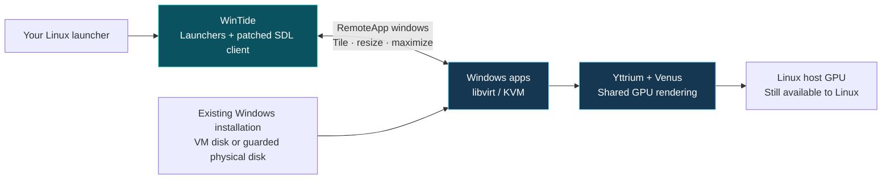

<div align="center">

# WinTide

### Windows apps. Linux flow.

Bring your Windows apps into your Linux workspace—with native Wayland windows, responsive resizing, and a shared GPU path that keeps Linux in control.

[Get started](docs/getting-started.md) · [What works](docs/validation.md) · [How we fixed it](docs/fixes.md) · [Credits](#credits)

**Linux + Windows 11 · libvirt / KVM · SDL3 / Wayland · Yttrium**

</div>

---

## Your apps, in your workspace

Open a Windows app from your Linux launcher. Tile it beside your Linux apps. Resize it, maximize it, and bring it back without fighting two window managers.

**WinTide is our implementation of that workflow:** a reproducible setup toolkit, RemoteApp client fixes, launcher integration, and VM lifecycle tooling built on WinApps, FreeRDP, Yttrium and libvirt. Use an existing Windows VM—or a supported physical Windows installation—while keeping your Linux desktop and host GPU available.



*Architecture illustration, not a recorded demo. No personal desktop screenshots or account data are bundled.*

WinTide grew out of frustration with the WinApps + xfreerdp experience on Hyprland. The goal is useful, reproducible integration for anyone bringing Windows apps into Linux, with SDL/Wayland fixes that are not tied to Hyprland. Hyprland is our tested starting point; other Wayland compositors still need validation.

## What WinTide brings

| Implementation | What it does for you |
|---|---|
| **SDL window-state and resize fixes** | Keep the remote Windows window restored while the local compositor controls its size. Settings and Explorer open tiled; maximize/restore and resizing work without repeated toggles. |
| **Correct Wayland size hints** | Remove the artificial maximum-size cap that caused resizable apps to be forced floating. No Hyprland-specific window rules. |
| **One connection, multiple apps** | Send additional launches through the existing RAIL session, avoiding repeated login screens and reopening all windows. |
| **Reliable RemoteApp startup** | Launch once after the RAIL handshake, fixing the observed login-image stall. |
| **Linux launcher integration** | Discover registered Windows executables, generate desktop entries, and provide a standalone Explorer broker. |
| **Guarded libvirt lifecycle** | Review a generated plan, preserve the existing VM configuration, protect physical disks from simultaneous host mounting, and retain rollback state. |
| **Shared GPU integration** | Build the pinned Yttrium QEMU/renderer stack and configure the matching Windows driver without dedicating the host GPU to passthrough. |
| **Optional Windows startup helper** | A small Rust/windows-rs helper restores newly shown maximized windows in the interactive RDP session. The SDL fix handles the cross-desktop state problem. |
| **Optional VirtioFS permission guard** | Allow content writes while preventing guest ACL translation from stripping Linux access permissions. |

Read the [implementation details](docs/fixes.md) and [launcher behavior](docs/winapps.md).

## What works today

The reference setup runs CachyOS/Hyprland, Windows 11 Pro on a physical NVMe disk, and an NVIDIA RTX 4070 Laptop GPU. We have verified:

- Windows apps launching into the Linux desktop through the patched SDL3 client.
- Settings and Explorer opening tiled, plus working resize and maximize/restore behavior confirmed interactively.
- Windows booting from its existing physical installation under libvirt, with host mount protection.
- Yttrium hardware **Direct3D 11 device creation and GPU clear/readback**, while Linux continues using the GPU.
- Optional VirtioFS read/write and permission protection against the reproduced mode-000 failure.

**This is an experimental desktop integration with tested components, not a universal gaming solution.** DirectX 12, individual games, other GPU vendors, other compositors and a clean-machine end-to-end installation have not been validated. The Windows graphics driver requires test signing; review [driver and security changes](docs/security.md).

VM hiding, identity spoofing, custom concealment firmware and anti-cheat bypass experiments are outside WinTide's scope and are no longer part of the setup toolkit.

## Get started

Start with an existing, bootable Windows 11 Pro/Enterprise VM in system libvirt, QEMU Guest Agent, and the [host prerequisites](docs/requirements.md). WinTide does not install Windows or guess how to repair your boot records.

```sh
git clone https://github.com/xizha127/WinTide.git
cd WinTide
cp examples/config.example.json local-config.json
chmod 600 local-config.json
# Edit local-config.json for your VM, desktop user and disks.
./setup.sh --config local-config.json doctor
./setup.sh --config local-config.json build
```

Then follow the [complete setup guide](docs/getting-started.md) for guest preparation, plan review, host integration and app launchers. Building alone does not configure the VM.

Existing installations keep their `winapps-yttrium` command, profile and service names for compatibility. The rebrand does not require reinstalling your working setup.

## Choose the right storage path

The Windows system disk is exclusively owned by the VM while it runs. Optional VirtioFS shares expose files mounted by Linux, rather than sharing raw filesystem ownership.

VirtioFS is useful for shared files, but sequential throughput did **not** translate into reliable Steam library behavior in our tests: validation and space reservation could be slow, and library size reporting was problematic. A directly attached Windows-owned NTFS game disk performed much better on the reference system. That later storage arrangement is not automatically provisioned by this installer. See [storage choices and limitations](docs/sharing.md).

## Explore the project

| Guide | Covers |
|---|---|
| [Getting started](docs/getting-started.md) | Reproduce the supported setup |
| [Physical disk and boot](docs/physical-disk.md) | Prepare an existing installation safely |
| [Windows apps](docs/winapps.md) | Launchers, Explorer, SDL and the optional helper |
| [Fixes](docs/fixes.md) | Our client and renderer changes |
| [Performance](docs/performance.md) | CPU placement, startup load and bottlenecks |
| [Validation](docs/validation.md) | Evidence, checks and remaining limits |
| [Rollback](docs/rollback.md) | Restore the previous configuration |
| [Privacy](docs/privacy.md) | Keep credentials and machine state out of Git |

Source versions and download checksums are pinned in [`components.lock.json`](components.lock.json). Original WinTide integration code is [MIT licensed](LICENSE); upstream patch contexts retain their own licenses. The separate [FreeRDP fork](https://github.com/xizha127/FreeRDP/tree/winapps-wayland-resize) contains earlier resize work; this repository's patch is the source of truth for the current setup.

## Credits

WinTide's implementations stand on substantial upstream work:

- **[WinApps](https://github.com/winapps-org/winapps)** and original creator **[Fmstrat](https://github.com/Fmstrat/winapps)** — the RemoteApp integration model and launcher core.
- **[FreeRDP](https://github.com/FreeRDP/FreeRDP)**, including **Ibrahim Sevinc's SDL3 RAIL work**, and **[SDL](https://libsdl.org/)** — the protocol and native Wayland window foundation we extend.
- **[arehnman / Yttrium](https://github.com/arehnman/yttrium-virtio-gpu)** — the Windows GPU driver and matching [QEMU](https://github.com/arehnman/yttrium-qemu), [renderer](https://github.com/arehnman/virglrenderer) and [Mesa integration](https://github.com/arehnman/virtio-win-mesa).
- **[QEMU](https://www.qemu.org/)**, **[KVM](https://linux-kvm.org/)**, **[libvirt](https://libvirt.org/)**, **[Mesa/Venus](https://www.mesa3d.org/)** and **[virglrenderer](https://gitlab.freedesktop.org/virgl/virglrenderer)** — virtualization and shared graphics infrastructure.
- **[VirtIO-Win](https://github.com/virtio-win/kvm-guest-drivers-windows)**, **[VirtioFS](https://virtio-fs.gitlab.io/)** and **[WinFsp](https://github.com/winfsp/winfsp)** — guest integration and optional file sharing.
- **[Microsoft windows-rs](https://github.com/microsoft/windows-rs)** — Windows API bindings for our Rust helper.

See [full attribution and license details](THIRD_PARTY.md), including firmware, console and TPM components. WinTide is an independent integration project, not an official product or endorsement from these projects.
